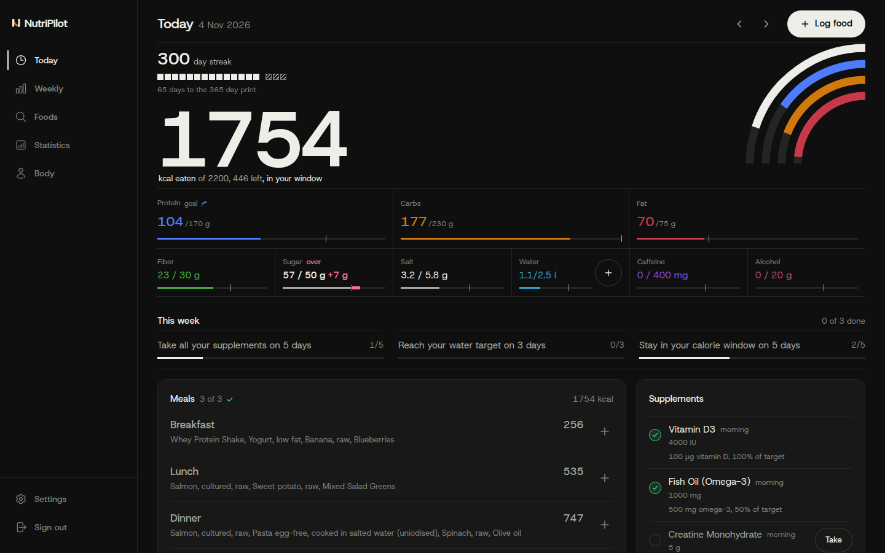
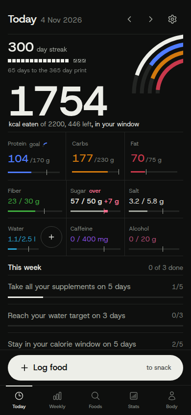
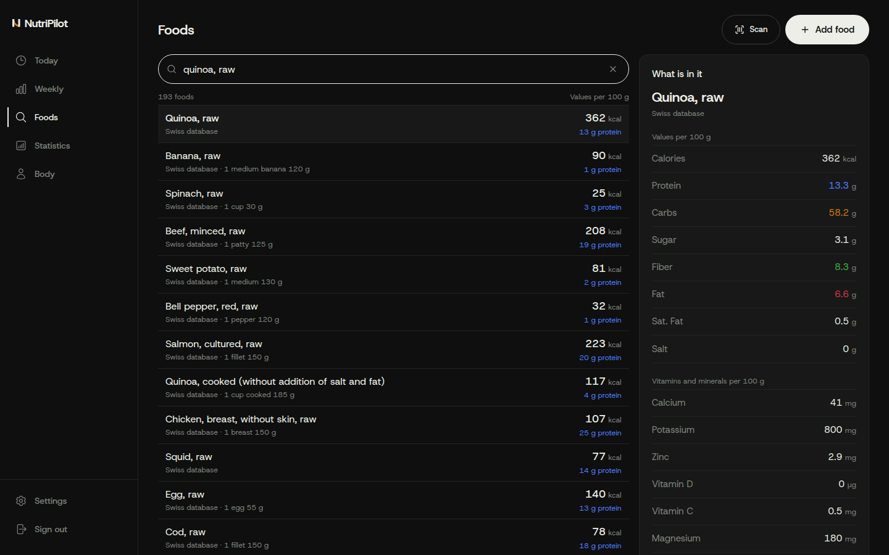
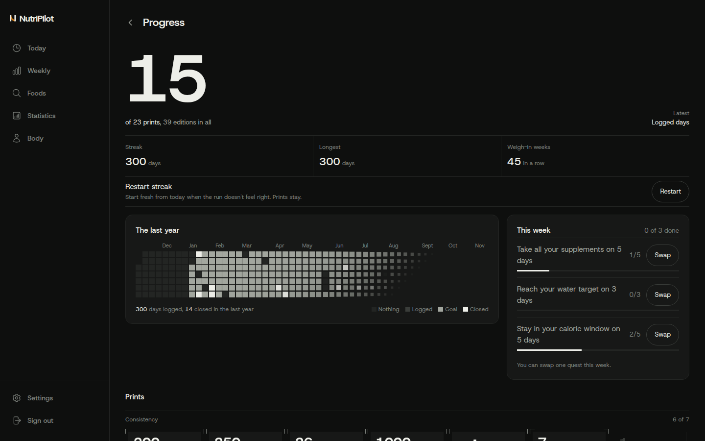
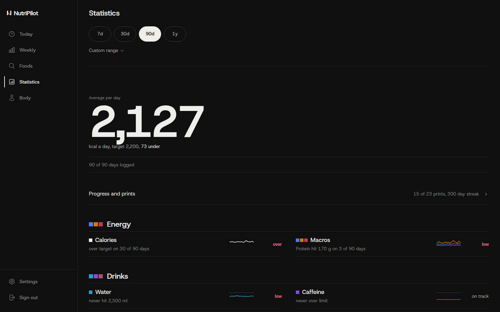
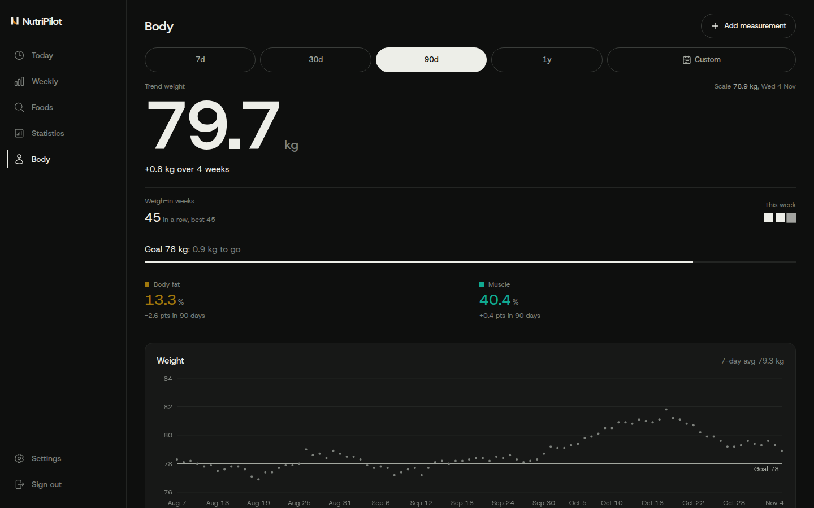
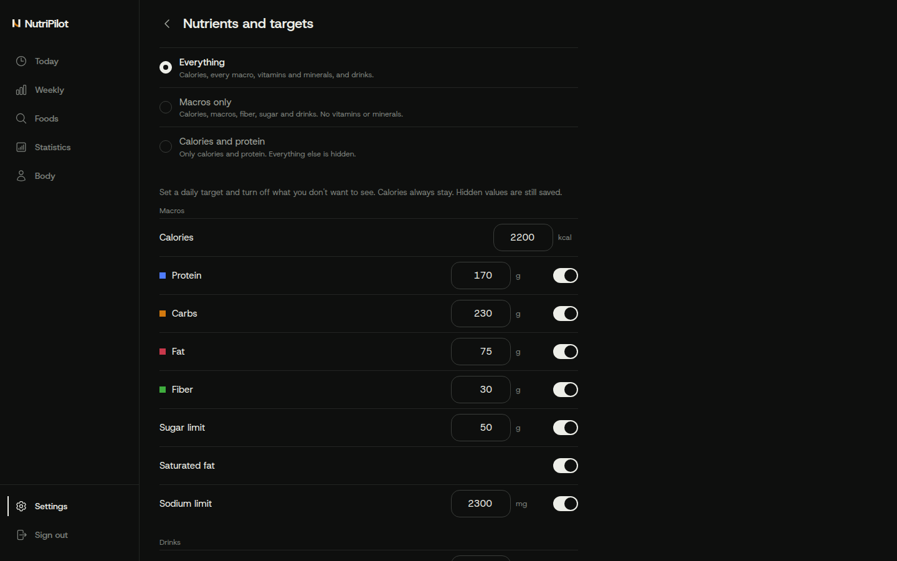
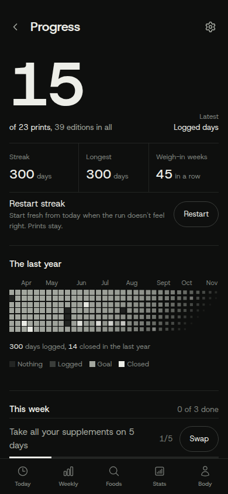
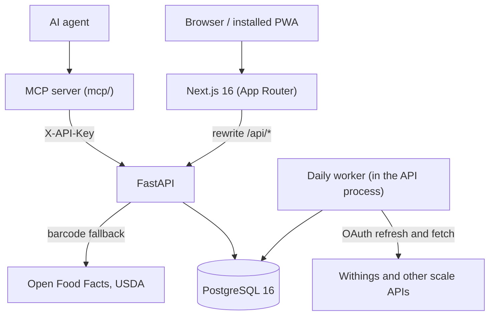

# NutriPilot

A personal nutrition and body-composition tracker that a person and an AI agent can both write to.
It is a project I built for my own daily use: one dark, Swiss-poster-style dashboard, a typed API,
and an MCP server so an assistant can keep the diary from plain language.

[](https://github.com/Pineacles/nutripilot/actions/workflows/ci.yml)
[](LICENSE)

<p>
  
  
</p>

## What it does

- **Logging.** Search foods with trigram fuzzy matching, scan a barcode with the camera, repeat recents
  in one tap, log in grams or named servings (a "slice", a "cup"), and copy a meal to another day.
  Unknown barcodes fall back to Open Food Facts (Swiss products first) and USDA FoodData Central.
- **Foods.** A Swiss food composition database seeds the shared catalog. Users can add foods and
  dishes (a dish is a list of component foods, nutrients computed from them), correct a food's
  nutrients, and keep foods private. Foods created by an agent are marked as estimates.
- **Tracking.** Calories, macros, fiber, sugar, salt, 10 micronutrients, water, caffeine, alcohol,
  supplements (with the micronutrients they contribute) and body composition (weight, body fat,
  muscle). Any nutrient except calories can be hidden in Settings.
- **Views.** Today, Weekly, Foods, Statistics (7 days to a year, custom ranges), Body (trend weight,
  goal progress, composition charts) and Progress.
- **Progress game.** Streaks with freezes, a "calorie window" day goal, prints (milestones),
  weekly quests and a Monday recap. Everything is recomputed from the logs, and nothing rewards
  eating under 1000 kcal.
- **Integrations.** Withings OAuth with a reconnect flow, plus configurable scale integrations that a
  daily worker syncs into weight logs.
- **Agent access.** A per-user API key opens the same data to an AI agent over REST, and the MCP
  server wraps it with validation and an undo journal.
- **PWA.** Installable, with a service worker and per-user timezones for day boundaries.

## Screens

<table>
  <tr>
    <td width="50%"><p align="center">Food search and detail</p></td>
    <td width="50%"><p align="center">Progress: streak, year grid, quests</p></td>
  </tr>
  <tr>
    <td width="50%"><p align="center">Statistics</p></td>
    <td width="50%"><p align="center">Body: trend weight and composition</p></td>
  </tr>
  <tr>
    <td width="50%"><p align="center">Nutrients and targets</p></td>
    <td width="50%" align="center"><p>Phone layout</p></td>
  </tr>
</table>

All screenshots are taken from the generated demo account (`demo@nutripilot.dev`).

## Architecture



The browser only ever talks to Next.js, which proxies `/api/*` to FastAPI. The API serves two
audiences from one codebase: the dashboard (JWT bearer) and agents (`X-API-Key`, or a JWT). Details
are in [docs/architecture.md](docs/architecture.md).

| Layer | Technology |
|---|---|
| Frontend | Next.js 16, React 19, TypeScript, Tailwind 4, TanStack Query, Recharts, ZXing |
| Backend | FastAPI, Python 3.12, async SQLAlchemy, Alembic, slowapi |
| Database | PostgreSQL 16 with `pg_trgm` |
| Agent | REST under `/api/agent`, stdlib-only MCP server in `mcp/` |
| Infra | Docker Compose (dev, production with Caddy, tunnel variant) |

## MCP server

`mcp/nutripilot_mcp.py` is a single file with no dependencies. It exposes `diary`, `progress`,
`find_food`, `log_meal`, `create_food`, `create_dish`, `edit_entry`, `delete_entry`, `undo`,
`log_weight` and `update_plan`. Safety is enforced in code: created foods are private estimates,
nutrient values are range-checked against the macros, deleting entries or changing targets needs
explicit confirmation, calorie floors and loss rates are refused, and every change is audited and
undoable for 24 hours. See [mcp/README.md](mcp/README.md).

## Security notes

- Passwords are hashed, refresh tokens are stored by `jti` and revocable, API keys are stored as
  SHA-256 digests with a visible prefix only.
- Every query is user-scoped, with an isolation test suite for cross-user access.
- Integration credentials are Fernet-encrypted at rest, with key rotation support.
- An SSRF guard rejects private, loopback and metadata addresses in integration URLs.
- Rate limits on auth, security headers, and production start-up checks for secrets and CORS.

## Run it locally

```bash
cp .env.example .env      # set POSTGRES_PASSWORD and JWT_SECRET
docker compose up -d --build
docker compose exec api python -m seed_demo    # optional: demo user with 90 days of data
```

Dashboard on http://localhost:3099, API on http://localhost:8099 (`/docs` in dev). Tests:
`cd backend && pytest -q` (255 tests, SQLite plus a throwaway Postgres for the migration test) and
`cd frontend && npm run lint && npx tsc --noEmit`.

## License

[MIT](LICENSE)
