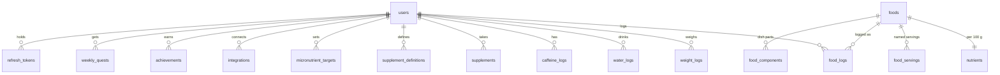

# Architecture

How the parts of NutriPilot fit together. Derived from the code, so it should be checked against
`backend/app/main.py` and `frontend/next.config.ts` when something looks off.

## Services

| Service | Role | Local port |
|---|---|---|
| `web` | Next.js 16 production build; proxies `/api/*`, `/health`, `/docs`, `/openapi.json` to the API | 3099 |
| `api` | FastAPI; runs `alembic upgrade head` on container start, then uvicorn | 8099 |
| `db` | PostgreSQL 16 (`pg_trgm` for fuzzy search) | 5488, localhost only |

Three Compose files: `docker-compose.yml` (local, ports bound to 127.0.0.1), `docker-compose.prod.yml`
(adds Caddy for TLS, `ENVIRONMENT=production`, two API workers) and `docker-compose.tunnel.yml`
(only the web port is exposed, for use behind a tunnel). Secrets come from `.env` (see
`.env.example`); there is no global API key.

## Backend (`backend/app`)

```
main.py            app wiring, middleware (CORS, security headers, rate limits), lifespan
config.py          settings; refuses weak secrets when ENVIRONMENT=production
auth/              JWT helpers, API-key hashing, one dependency accepting JWT or API key
routers/           auth, foods, dashboard, game, settings, agent/*
services/          food, logging, summary, progress, game, dish, barcode, sync worker, crypto, url_guard
external/          Open Food Facts and USDA clients, nutrient sanity checks
models/            SQLAlchemy models
schemas/           Pydantic request and response models
demo_daily.py      generates today's data for the demo account
```

### Routers

| Prefix | Purpose | Auth |
|---|---|---|
| `/api/auth` | login, refresh, logout (rate limited) | credentials, refresh token |
| `/api/dashboard` | today, weekly, stats, weight, food search and detail, nutrient sources | JWT |
| `/api/dashboard/game` | streak, prints, quests, recap, day corrections | JWT |
| `/api/v1` | settings, targets, tracked nutrients, supplement definitions, API key regeneration, integrations list | JWT |
| `/api/foods` | catalog search, barcode lookup, create, clone, edit, correct, delete, servings | JWT or API key |
| `/api/agent` | food, water, caffeine, supplement and weight logs, dishes, profile, progress, summaries, integrations, game, Withings OAuth | JWT or API key |

The dashboard and the agent API share the same services, so a meal logged by an agent shows up in the
dashboard with no extra step.

### Data model



- `foods` has a nullable `created_by` and a `private` flag. Catalog foods (`created_by` null) are
  read-only; user foods can only be changed by their owner; private foods are invisible to others.
  `source` records where a food came from (Swiss database, Open Food Facts, USDA, manual, AI estimate).
- `nutrients` holds values per 100 g: kcal, protein, carbs, sugar, fiber, fat, saturated fat, salt,
  alcohol, caffeine and ten vitamins and minerals.
- `food_logs` stores grams plus the unit the user entered (`amount`, `unit`, `unit_label`) and a meal type.
- `users` carries targets, profile (height, birth year, sex, activity), timezone, hidden nutrients and
  JSON blobs for game settings, day goals and game state. The API key is stored as a SHA-256 digest.
- `integrations` keeps the source URL, an encrypted auth value and a field mapping (Fernet via a
  SQLAlchemy `TypeDecorator`).
- Game state is recomputed from logs on request; only earned prints (`achievements`) and weekly
  quests are stored.
- Migrations are in `backend/alembic/versions` (Postgres DDL). A test runs them against a throwaway
  Postgres and compares the result with the models.

### Background work

One asyncio task started in the lifespan handler seeds the demo account at startup and about 00:05,
and runs integration syncs at startup and about 06:00 (disable with `INTEGRATION_SYNC=false`). A sync
refreshes the OAuth token, fetches the latest measurements and upserts weight logs idempotently.

## Frontend (`frontend/src`)

- Routes: `/today`, `/weekly`, `/foods`, `/scanner`, `/statistics`, `/body`, `/progress`, `/login`,
  and `/settings` with sub pages `nutrients`, `goals`, `supplements`, `connections`, `app`.
- Data access is TanStack Query hooks in `hooks/` over the typed client in `lib/api.ts`; the access
  token is refreshed through the refresh endpoint.
- `components/` is grouped by domain (today, food-log, scanner, body, statistics, game, settings, ui).
- Design rules (Swiss poster on near-black, one display figure per screen, plate colours per
  nutrient) are in `docs/design-vision.md`.

## MCP server (`mcp/`)

A single stdlib-only Python file speaking MCP over stdio. It calls the agent API with a user API key,
keeps a local undo journal and audit log, and validates inputs before anything is sent. Tool list and
safety rules are in `mcp/README.md`.

## Request flow example

1. The dashboard calls `POST /api/agent/log/food` (or an agent does, via the MCP `log_meal` tool).
2. The dependency resolves the user from the JWT or the API key.
3. The logging service resolves the food, computes grams from the entered unit and stores a `food_logs` row.
4. `GET /api/dashboard/today` sums the day from `food_logs` and `nutrients` against the user's targets.
